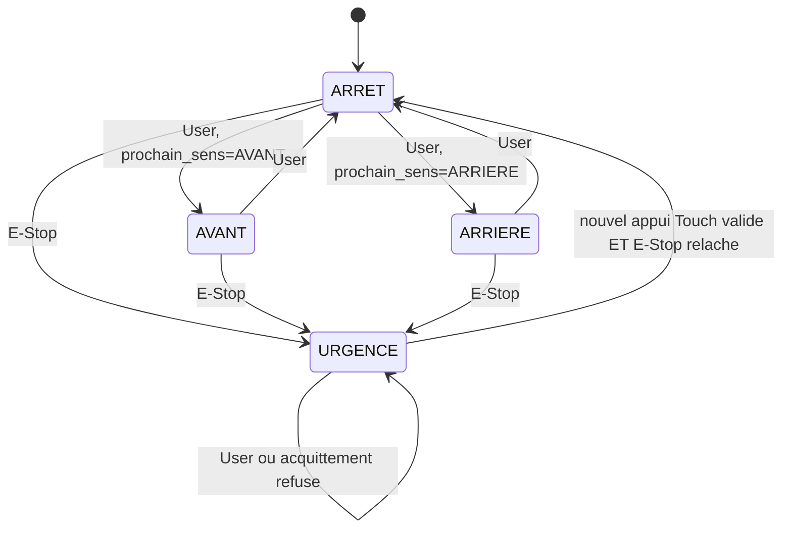

# Démonstration sur la carte et éléments du rapport

Le code permet de présenter les fonctions E1 à E9. Les essais ci-dessous constituent un **protocole**, et non des résultats déjà obtenus sur votre carte. Conserver les observations réelles dans `preuves/RESULTATS_CARTE.csv`, avec les captures du débogueur. L'énoncé v1.2 ne demande plus les mesures à l'oscilloscope des diapositives v1.1.

## 1. Préparer le débogueur

Compiler, charger et reprendre l'exécution. Dans **Expressions** ou **Live Expressions**, ajouter les expressions suivantes. L'assembleur n'émet pas toujours les types C des variables; ces conversions explicites évitent le message « unknown type » de GDB.

| Expression | Interprétation |
|---|---|
| `*(unsigned int *)&etat` | 0 arrêt; 1 avant; 2 arrière; 3 urgence |
| `*(unsigned int *)&compteur_transitions` | Transitions d'état, y compris entrée et sortie d'urgence; Touch seul ne l'incrémente pas |
| `*(unsigned int *)&estop_flag` | 1 après ISR, consommé au pas suivant; souvent trop bref pour Live Expressions |
| `*(unsigned int *)&touch_enabled` | Autorisation 0/1 |
| `*(unsigned int *)&prochain_sens` | 1 avant ou 2 arrière pour le prochain départ |
| `((unsigned int *)&btn_valide)[0]` | Niveau validé User; index 1 E-Stop, index 2 Touch |
| `((unsigned int *)&btn_compteur)[0]` | Compteur User; index 2 pour Touch |
| `*(unsigned int *)&dwt_ready` | Doit être 1 pour exploiter les mesures DWT |
| `*(unsigned int *)&blink_samples` | Nombre de basculements mesurés depuis l'entrée en urgence |
| `*(unsigned int *)&blink_cycles` | **Dernière demi-période**, en cycles |
| `*(unsigned int *)&blink_period_cycles` | Somme des deux dernières demi-périodes; exploitable après au moins 2 basculements |
| `*(unsigned int *)&delay_boucles_par_ms` | Valeur RAM de calibration, initialement 1000 |

`btn_valide[1]` et `btn_compteur[1]` restent à zéro dans l'application : E-Stop passe par interruption et sa lecture brute sert à l'acquittement. Les trois entrées sont néanmoins prises en charge par l'interface `button_pressed` pour sa réutilisation.

Dans **SFRs**, observer GPIOA/B/C (MODER, PUPDR, IDR, ODR), RCC_AHB2ENR, EXTI et NVIC. Si SFRs manque, utiliser :

```c
(*(volatile unsigned int *)0x42020810 >> 13) & 1 /* PC13 : User */
(*(volatile unsigned int *)0x42020410 >> 2) & 1  /* PB2 : E-Stop */
(*(volatile unsigned int *)0x42020410 >> 5) & 1  /* PB5 : Touch En */
(*(volatile unsigned int *)0x42020014 >> 9) & 1  /* PA9 : rouge */
(*(volatile unsigned int *)0x42020814 >> 7) & 1  /* PC7 : verte */
(*(volatile unsigned int *)0x42020414 >> 7) & 1  /* PB7 : bleue */
```

Retirer les commentaires si l'éditeur d'expressions les refuse. Une capture d'ODR vérifie les bits de sortie, pas la latence électrique de la broche.

## 2. T4 : confirmer les boutons avant les autres essais

Lire chacun des trois bits IDR, bouton relâché puis appuyé. `BTN_x_ACTIF_HAUT=1` correspond à relâché 0 / appuyé 1; mettre `0` pour relâché 1 / appuyé 0. Dans `Core/Src/registres.inc`, adapter séparément User, E-Stop et Touch En, puis recompiler et recharger. La sélection RTSR1/FTSR1 suit automatiquement la polarité E-Stop.

Pour PUPDR : 0 = aucun rappel, 1 = tirage haut, 2 = tirage bas. Justifier à partir du câblage et des lectures; une seule lecture de niveau ne suffit pas à prouver la présence d'un rappel externe. Si les deux lectures restent identiques, vérifier le câblage et le bouton avant de choisir une polarité.

| Entrée | IDR relâché | IDR appuyé | Actif haut 0/1 | PUPDR et justification |
|---|---|---|---|---|
| PC13 User | à relever | à relever | à confirmer | à confirmer |
| PB2 E-Stop | à relever | à relever | à confirmer | à confirmer |
| PB5 Touch En | à relever | à relever | à confirmer | à confirmer |

## 3. T6 / E8 : calibrer la cadence à 4 MHz

La boucle principale fait `fsm_step`, puis `delay_ms(1)`. Les compteurs représentent des **pas de scrutation**, donc il faut calibrer la cadence globale, qui inclut le travail de `fsm_step`. L'anti-rebond vaut 30 pas, l'extinction Touch 100 pas et une demi-période d'urgence 250 pas. `delay_ms` laisse les interruptions autorisées.

1. Confirmer l'horloge de reset MSI 4 MHz; `SystemInit` ne modifie pas RCC. Les champs 4 MHz du projet/debug sont des métadonnées, pas une configuration RCC.
2. Entrer en urgence avec E-Stop et le relâcher. Vérifier `dwt_ready=1` et `blink_samples>=3`. Laisser tourner sans arrêt, pas-à-pas ou breakpoint durant la mesure.
3. À 4 MHz : `demi_periode_ms = blink_cycles / 4000.0`; `periode_ms = blink_period_cycles / 4000.0`. Viser respectivement **250 ms** (1 000 000 cycles) et **500 ms** (2 000 000 cycles). Plages ±10 % : 225–275 ms et 450–550 ms.
4. Si nécessaire, modifier `delay_boucles_par_ms` en RAM avec le débogueur. Première approximation : `N_nouveau = arrondi(N_actuel × 500 / periode_mesuree_ms)`, minimum 1. Attendre au moins trois nouveaux basculements après une modification et remesurer. L'approximation néglige le coût fixe, d'où la nécessité d'itérer.
5. Enregistrer la valeur retenue dans `DELAY_BOUCLES_PAR_MS` de `registres.inc`, recompiler, recharger et refaire T3/T6/T9. Une modification Watch disparaît au reset.

Pour distinguer le coût fixe de la boucle : mesurer une période complète `P1` à `N1`, puis `P2` à `N2`, en cycles. Il y a 500 appels du délai par période si la scrutation vaut 1 ms. Estimation expérimentale : `cycles_par_iteration = (P2-P1)/(500*(N2-N1))`; `cout_fixe_par_pas = P1/500 - cycles_par_iteration*N1`. On peut alors estimer `N_cible = (4000-cout_fixe_par_pas)/cycles_par_iteration`. Choisir deux valeurs raisonnablement séparées, utiliser plusieurs périodes et noter la méthode. Les cycles de branche dépendent du pipeline et des accès flash : ne pas déclarer sans mesure que `subs; bne` coûte toujours le même nombre de cycles.

Le mode normal et le mode urgence n'exécutent pas exactement le même nombre d'instructions. Vérifier aussi le comportement anti-rebond et la signalisation après calibration; cette limite de la boucle occupée sera éliminée avec une base de temps périodique au laboratoire 2. Les lectures DWT encadrent le changement de phase logiciel, quelques instructions avant l'écriture GPIO. Elles conviennent au contrôle de période du laboratoire; elles ne mesurent pas directement une broche.

Si `dwt_ready=0`, ne pas utiliser les valeurs nulles comme mesures. Vérifier `DEMCR.TRCENA`, `DWT_CTRL.CYCCNTENA`, la configuration de débogage et les droits d'accès du cœur. La FSM continue à fonctionner, mais T6 n'est pas validé. Une pause du débogueur peut perturber une mesure; reprendre et attendre plusieurs demi-périodes.

## 4. Démontrer T1 à T10

| Essai | Action sur la carte | Résultat attendu et preuve à conserver |
|---|---|---|
| T1 | Relâcher tous les boutons; appuyer sur uC Reset, reprendre si le débogueur s'arrête | `etat=0`, rouge seule; capture ODR et état. Le critère de démarrage est <100 ms; ne pas inclure le temps volontairement arrêté sur `main`. |
| T2 | Quatre appuis distincts sur User, avec relâchement entre les appuis | États 1,0,2,0; verte,rouge,bleue,rouge. Capturer ODR à chaque étape. |
| T3 | Reset; noter le compteur, faire 20 appuis; puis maintenir un nouvel appui 2 s | Différences du compteur +20 puis +1. Un appui et un relâchement doivent chacun dépasser la fenêtre de 30 ms. |
| T4 | Lire PC13/PB2/PB5 relâchés et appuyés | Tableau de polarités et PUPDR rempli avec valeurs réelles; voir section 2. |
| T5 | Passer en avant, appuyer E-Stop; répéter en arrière | ISR éteint verte/bleue, allume rouge, positionne le drapeau et acquitte EXTI; `etat=3` au pas suivant. Pour voir `estop_flag=1`, arrêter **après son écriture** dans l'ISR, puis reprendre. Un breakpoint à l'entrée est avant la mise en sécurité. |
| T6 | Rester en urgence et laisser tourner librement | Relever plusieurs `blink_cycles` et `blink_period_cycles`, convertir et vérifier la tolérance. Capturer valeur de calibration et fréquence supposée/confirmée. |
| T7 | E-Stop maintenu : appuyer Touch puis le relâcher. Relâcher E-Stop sans nouvel appui Touch. Ensuite refaire un appui Touch | Refus; urgence conservée après le seul relâchement E-Stop; puis arrêt rouge fixe au nouvel appui Touch. Pas de redémarrage automatique. |
| T8 | Appuyer plusieurs fois User en urgence | État reste 3, compteur de transitions inchangé. L'anti-rebond User continue à être entretenu. |
| T9 | En arrêt, appuyer deux fois Touch avec relâchement | `touch_enabled` passe 0→1→0; rouge éteinte environ 100 ms à chaque appui. L'état ne change pas. |
| T10 | User+Touch ensemble; E-Stop pendant transition, extinction Touch ou clignotement; User+Touch lors d'un acquittement | Au plus une DEL, pas de mouvement après l'ISR, priorité à l'urgence. Acquittement simultané à User revient à l'arrêt. Captures et description des essais répétés. |

Le compteur compte **toutes les transitions d'état** : mesurer des différences pour T3 et éviter E-Stop pendant ces vingt appuis. Une pression E-Stop maintenue au démarrage provoque volontairement une urgence par une requête NVIC logicielle; pour démontrer l'état initial normal de T1, la relâcher avant reset.

Pour démontrer l'interruption pendant une temporisation longue, on peut remplacer temporairement dans `main.s` le paramètre du délai par 2000, recompiler puis appuyer E-Stop pendant ce délai. L'ISR doit toujours agir immédiatement. Cette variante ralentit toute la scrutation et ne sert **qu'à T5** : rétablir la valeur de 1 ms, recompiler et recharger avant les autres essais.

## 5. Conception à expliquer



`prochain_sens` commence à AVANT et est inversé à chaque départ depuis ARRÊT. Après acquittement, il revient à AVANT, choix explicite puisque l'énoncé ne précise pas la reprise du cycle après urgence. Touch hors urgence inverse `touch_enabled` sans changer l'état. Les événements User et Touch simultanés hors urgence réalisent les deux opérations; l'extinction Touch masque brièvement la nouvelle DEL.

**Anti-rebond.** Le niveau brut est comparé au dernier niveau validé. Identique : compteur remis à zéro. Différent : incrémenter; adopter le niveau après 30 échantillons consécutifs. Retourner 1 seulement lors de l'adoption du niveau appuyé. Un relâchement est filtré mais ne produit pas d'événement.

**Interruptions et courses.** BSRR rend une écriture sur un port atomique, mais ne rend pas atomiques les écritures sur trois ports. Sans protection, l'ISR peut allumer la rouge, puis la routine interrompue reprendre et allumer la verte. La version livrée sauvegarde PRIMASK et masque brièvement les IRQ pendant la transaction d'état et de sorties; elle restaure ensuite la valeur précédente. `led_set` protège aussi son utilisation directe et refuse verte/bleue si une urgence est signalée. Aucun délai, aucune boucle de temporisation n'est exécuté dans ces sections critiques. Une IRQ arrivée pendant le masquage reste en attente et est servie à sa levée.

L'ISR se limite à trois écritures BSRR, au drapeau et aux effacements RPR1/FPR1, suivis d'une barrière. La FSM consomme le drapeau et change l'état. Les rebonds E-Stop ne réinitialisent pas le compteur de clignotement lorsque l'état est déjà urgent; chaque nouvelle ISR impose néanmoins momentanément la rouge. Un nouvel E-Stop prévaut sur les événements User/Touch du même pas. L'initialisation de la FSM précède l'activation d'EXTI pour ne pas écraser une urgence déjà reçue.

**Analyse E4 (<10 ms).** À 4 MHz, 10 ms représentent 40 000 cycles. La réaction comprend la fin éventuelle d'une courte section critique, l'entrée d'exception puis les premières écritures de l'ISR; elle ne dépend pas de la durée de `delay_ms`. Le test d'émulation a observé 89 instructions masquées sur le chemin de transition testé, ce qui est un comptage d'instructions, **pas une mesure de cycles ni une borne matérielle exhaustive**. Examiner le désassemblage et les coûts d'accès du Cortex-M33/RM0438 pour justifier le budget dans le rapport. Ne pas présenter le temps d'une session de débogage avec breakpoint comme la latence E-Stop. D'autres longues sections masquées ajoutées ultérieurement changeraient l'analyse.

**AAPCS.** Paramètres R0–R3, résultat R0; sauvegardes de R4–R6 et LR dans les routines appelantes. Empilements de 8 ou 16 octets, pile alignée sur 8. L'ISR feuille utilise seulement les registres déjà sauvegardés par le matériel. `main` ne retourne jamais. `fsm_maj_del` reste le seul appel applicatif de `led_set`; les écritures directes de l'ISR sont l'exception imposée par E4.

## 6. Registres à documenter

Les valeurs ci-dessous sont celles des **champs concernés**, les autres bits étant préservés.

| Registre | Adresse / champ | Configuration |
|---|---|---|
| RCC_AHB2ENR | `0x4002104C`, bits 2:0 | `111` : horloges GPIOA/B/C |
| GPIOA_MODER | `0x42020000`, bits 19:18 | `01`, PA9 sortie |
| GPIOC_MODER | `0x42020800`, bits 15:14 et 27:26 | `01` PC7 sortie; `00` PC13 entrée |
| GPIOB_MODER | `0x42020400`, bits 15:14, 5:4, 11:10 | `01` PB7 sortie; `00` PB2 et PB5 entrées |
| GPIOx_OTYPER | base + `0x04`, bit de chaque DEL | 0, push-pull |
| GPIOx_OSPEEDR | base + `0x08`, champ de chaque DEL | `00`, basse vitesse |
| GPIOx_PUPDR | base + `0x0C` | DEL : 00; boutons : constantes confirmées par T4 |
| GPIOx_IDR | base + `0x10` | Lecture brute, normalisée par `button_raw` |
| GPIOx_BSRR | base + `0x18` | Bas 16 bits : mettre à 1; haut 16 bits : mettre à 0 |
| EXTI_EXTICR1 | `0x4002F460`, bits 18:16 | `001`, port B pour EXTI2; registre situé dans EXTI |
| EXTI_RTSR1 / FTSR1 | `0x4002F400` / `0x4002F404`, bit 2 | Actif haut : 1/0; actif bas : 0/1 |
| EXTI_RPR1 / FPR1 | `0x4002F40C` / `0x4002F410` | Écriture `0x4` pour effacer la requête ligne 2 |
| EXTI_IMR1 | `0x4002F480`, bit 2 | 1, ligne démasquée |
| NVIC_IPR + 13 | `0xE000E40D`, octet | 0, priorité maximale |
| NVIC_ISER0 | `0xE000E100` | Écriture `0x2000`, IRQ13 activée |
| DEMCR | `0xE000EDFC`, bit 24 | TRCENA=1 pour DWT |
| DWT_CTRL | `0xE0001000`, bit 0 | CYCCNTENA=1 |
| DWT_CYCCNT | `0xE0001004` | Lecture des cycles pour les mesures |

## 7. Rapport et laboratoire 3

Les sections conception, réalisation et méthode d'essai peuvent s'appuyer sur ce guide et le code commenté. Compléter les **observations**, captures, polarités, calibration, résultats T1–T10, contributions des membres et références Git à partir du travail réel. Le programme ne peut pas produire ces preuves à la place d'un essai sur votre matériel.

Routine proposée pour L3-A : `button_pressed(uint32_t id)`. Conserver ses cas d'essai : aucun appui → 0; impulsion de 12 pas → 0; appui stable de 30 pas → un seul 1; maintien prolongé → aucun nouveau 1; relâchement 30 pas puis nouvel appui → un nouveau 1; identifiant invalide → 0. La routine doit être appelée une fois par période pour chaque bouton suivi.

Limites à discuter : arrêt logiciel sans coupure d'alimentation; boutons sans filtrage matériel complet; attente occupée dépendante de la fréquence et du coût de la FSM; vérification brute de l'état E-Stop au moment de l'acquittement; absence de garantie de sécurité matérielle. Améliorations L2/L3 : base de temps SysTick et comparaison avec une implémentation C de la routine conservée.

Inclure la déclaration d'assistance IA et les sources de `LISEZMOI.md`. Le code complet et les essais simulés sont fournis pour être compris, vérifiés et expliqués lors de la démonstration.
